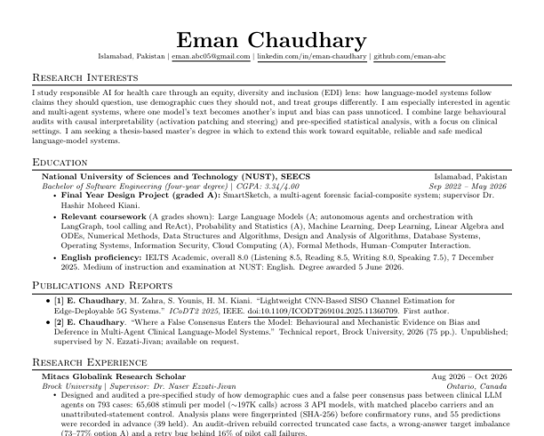

<h1 align="center">Hi, I'm Eman Chaudhary</h1>
<h3 align="center">Responsible AI for health care &middot; LLM interpretability &middot; Agentic systems &middot; NUST '26</h3>

<p align="center">
  <a href="https://www.linkedin.com/in/eman-chaudhary/"></a>
  <a href="mailto:eman.abc05@gmail.com"></a>
  <a href="https://github.com/eman-abc/eman-abc/blob/main/Eman_Chaudhary_Research_Resume.pdf"></a>
</p>

---

## Research Statement

<table align="right">
  <tr>
    <td align="center">
      <a href="https://github.com/eman-abc/eman-abc/blob/main/Eman_Chaudhary_Research_Resume.pdf">
        
      </a>
      <br>
      <strong>Research resume (PDF)</strong>
    </td>
  </tr>
</table>

I study responsible AI for health care through an equity, diversity and inclusion (EDI) lens: how language-model systems follow claims they should question, use demographic cues they should not, and treat groups differently. I am especially interested in **agentic and multi-agent systems**, where one model's text becomes another's input and bias can pass unnoticed.

I combine large behavioural audits with **causal interpretability** (activation patching and steering) and **pre-specified statistical analysis** (locked analysis plans, held-out confirmation, equivalence tests). I also build human-in-the-loop agentic systems, so I care about repairs that can actually be deployed.

**Currently:** Full Stack AI Intern at Savv Pro Solutions, and applying to thesis-based master's programs in Canada for Fall 2027.

---

## Research

### Mitacs Globalink Research Scholar, Brock University (Aug - Oct 2026)
*Supervisor: Dr. Naser Ezzati-Jivan*

**Where a False Consensus Enters the Model: Behavioural and Mechanistic Evidence on Bias and Deference in Multi-Agent Clinical Language-Model Systems** (75-page technical report, unpublished; available on request)

- Pre-specified audit of how demographic cues and a false peer consensus pass between clinical LLM agents: 793 cases, 3 API models and 5 open-weight models, about 197K calls, with matched placebo carriers and an unattributed-statement control.
- **Activation patching** (PyTorch, TransformerLens, Hugging Face hooks): in the open-weight models a false consensus moved answers strongly, and attention rather than MLP outputs carried the effect in all ten model-route settings.
- **Steering** with a cross-fitted mean-difference direction generalized to held-out cases in 8 of 10 settings but undid only part of the effect. Demographic footers were linearly decodable yet inert.
- Audit-driven rebuild fixed truncated case facts, a wrong-answer target imbalance and a retry bug behind 16% of pilot call failures.

### Publication

**Lightweight CNN-Based SISO Channel Estimation for Edge-Deployable 5G Systems.** E. Chaudhary, M. Zahra, S. Younis, H. M. Kiani. *ICoDT2 2025*, IEEE. First author. [IEEE Xplore](https://ieeexplore.ieee.org/document/11360709)

- Lightweight CNN and CNN-Transformer channel estimators (101-745 parameters) reaching NMSE as low as **-11.9 dB**, better than LS and MMSE baselines, with **<1 ms** inference on NVIDIA Jetson hardware via INT8 quantization and structured pruning. Research Intern at the SINES EmbedAIoT Lab, NUST (supervisor: Dr. Shahzad Younis).
- Code: [Edge AI for 5G](https://github.com/Muqadas2/Deep-Learning-Data-Synthesis-for-5G-channel-estimation)

### NASA OSDR AIML Analysis Working Groups (Sep - Nov 2025)

- Classified DNA-damage patterns in fibroblast nuclei (OSD-366, severely imbalanced 6-class data) with an attention-based CNN, selecting models by macro-F1.
- Built an ArrayRecord + Grain data pipeline that removed a cloud I/O bottleneck and cut per-epoch loading time by about 14%.

### Research projects

#### [Lightweight CNN-BiGRU for Human Activity Recognition](https://github.com/eman-abc/HAR) (ongoing)
> `TensorFlow` `PyTorch` `Knowledge Distillation` `INT8 Quantization` `Structured Pruning`

- **99.7% fewer parameters** than a HARDenseRNN baseline (33.7M to 90,066) with accuracy 95.21% and macro-F1 87.08% on WISDM.
- Teacher-student distillation produced a 2,790-parameter CNN student; quantization, pruning and weight clustering reached a **27.45 KB** model.

#### [SmartSketch: Multi-Agent Forensic Facial Composite System](https://github.com/eman-abc/SmartSketchAI) (final-year project, graded A)
> `LangGraph` `SDXL 1.0` `LoRA` `ControlNet` `Qwen2.5` `OpenAI CLIP` `FastAPI`

*Supervisor: Dr. Hashir Moheed Kiani*

- 4-stage multi-agent pipeline (analyze, route, artist, verify) with checkpointed state, schema-validated outputs and NSFW/age safety gates.
- Closed-loop evaluation (CLIP alignment, face-identity similarity, SSIM, Qwen2.5-VL critic) raised mean CLIP score from 0.61 to 0.65; shared diffusion components cut synthesis time by **50% (about 8.1 s per edit)**.

#### Sign2Text: self-supervised sign-language video-text alignment (prototype)
> `BYOL` `3D ResNet` `CLIP-style alignment` `BERT` `PyTorch`

- BYOL-pretrained 3D ResNet encoder aligned with BERT text embeddings on about 1,000 sign clips; evaluated with Recall@K retrieval.

---

## Industry Experience and Projects

### Full Stack AI Intern, Savv Pro Solutions (Nov 2026 - present)
Contributing to an on-premises AI front-office assistant for a private healthcare clinic (in progress): a local open-weight language model drafts replies, staff approve every message before it is sent, and client data stays on a clinic-hosted server. Scope includes red-flag message escalation checked against a labelled test set, a fallback that works without the model, and prompt-injection detection.

### Bilingual Clinic Voice Agent: Retrieval, Knowledge Graph and Safety Gates
> `Python` `FastAPI` `Elasticsearch` `Neo4j` `LangGraph` `Docker Compose` `pytest`

- English/Urdu retrieval layer with a custom Urdu analyzer; benchmarked four analyzers plus dense and hybrid search on 79 hand-labelled queries with bootstrap confidence intervals.
- Neo4j knowledge graph (28 nodes, 58 relationships) for GraphRAG-style answers with source provenance.
- LangGraph agent with deterministic safety gates (identity check, propose-then-confirm, emergency guard, rules fallback); 600+ automated tests and 66 golden scenarios (16 in Urdu).

### [AI-Driven Customer Service Assistant for NUST Bank (RAG System)](https://github.com/eman-abc/nust-bank-llm-assistant)
> `Gemma-3-4B` `PEFT/LoRA` `Qdrant` `sentence-transformers` `Presidio` `Celery` `FastAPI` `Redis` `Gradio` `Docker`

- Hybrid retrieval (dense `all-MiniLM-L6-v2` + BM25) with a cross-encoder reranker (`ms-marco-MiniLM-L-6-v2`); about 20% fewer irrelevant chunks than dense-only on a 100-query test.
- Gemma-3-4B fine-tuned with LoRA (rank 8, alpha 16) on domain banking FAQs.
- Guardrails: DeBERTa prompt-injection detection (95% of 40 attack prompts caught), post-generation confidence gating (threshold 0.8) and regex PII leak prevention.
- Presidio + spaCy PII anonymization before indexing; async ingestion with Celery and Redis; live index updates in Qdrant without retraining.

### [LeadStream-Voice: AI-Powered B2B Call Triage Platform](https://github.com/eman-abc/LeadStream-voice)
> `Node.js` `TypeScript` `Groq API (Llama-3.1)` `Vapi` `Docker` `Render` `WebSockets` &nbsp;|&nbsp; **[Live demo](https://dino-voice.onrender.com)**

- Native TypeScript state machine for routing and entity-aware conversation state, with no LangChain or LangGraph dependency, for low time-to-first-token.
- Three-layer hallucination defence: API stop sequences, full conversation history, and post-processing regex.
- Async end-of-call pipeline using Groq JSON mode for entity extraction and CRM injection; WebSocket dashboard of live call states.

### [Industrial Predictive Maintenance System (NASA C-MAPSS)](https://github.com/eman-abc/predictive-maintenance)
> `Python` `scikit-learn` `PyTorch (LSTM)` `MLflow` `FastAPI` `Streamlit` `Ollama` `Databricks SQL` `Delta Lake` `Docker Compose`

- Three-phase pipeline over C-MAPSS FD001-FD004; RUL regressors (RF, GBM, PyTorch LSTM), failure classifiers and an Isolation Forest anomaly detector. A GBM was selected over LSTM baselines (NASA score 10.31) after 20+ tracked MLflow experiments.
- Threshold engine with P1/P2/P3 SLA-based work-order routing into Databricks Delta Lake tables.
- Grounded asset briefings from a local Llama 3.2 (Ollama) served through a FastAPI backend; deployed with Docker Compose.

### [Full-Stack and Cloud Platforms (Vid City + MERN Marketplace)](https://github.com/eman-abc)
> `React` `Node.js` `Express.js` `MongoDB` `GCP` `Docker` `REST APIs`

- Video-streaming platform as microservices on Google Cloud; MERN marketplace and mentorship platform with role-based authentication (buyer, seller, admin dashboards).

---

## Tech Stack

**Research methods**
```text
Bias and fairness auditing (counterfactual, placebo-controlled) · Activation patching · Activation steering
Linear probes · Bootstrap CIs · Equivalence tests · Pre-specified analysis plans · LLM evaluation and benchmarking
```

**LLMs and agents**
```text
LoRA/PEFT · RAG and hybrid retrieval · LangGraph · LangChain · LlamaIndex · n8n · Tool calling
Human-in-the-loop agents · Guardrails · Prompt-injection defence · Ollama · Gemma · Qwen · Llama
```

**ML and deep learning**
```text
PyTorch · TensorFlow · TransformerLens · Hugging Face (transformers, diffusers) · scikit-learn
Knowledge distillation · INT8 quantization · Structured pruning · Edge AI (NVIDIA Jetson)
```

**Full stack, data and DevOps**
```text
Python · TypeScript · React · FastAPI · Django · Node.js · PostgreSQL · MongoDB · Elasticsearch · Neo4j · Qdrant · FAISS
Databricks SQL · Delta Lake · Celery · Redis · Docker Compose · GCP · AWS (S3) · Git · Linux
```

---

## Highlights

|  |  |
| --- | --- |
| **Mitacs Globalink Research Scholar** | Fully funded AI research, Brock University, Canada (2026) |
| **IEEE publication (first author)** | ICoDT2 2025: lightweight CNNs for 5G channel estimation, [IEEE Xplore](https://ieeexplore.ieee.org/document/11360709) |
| **NUST** | B.E. Software Engineering, 2022-2026, final-year project graded A |
| **English** | IELTS Academic 8.0 overall (December 2025) |

---

<p align="center">
<i>Applying to thesis-based master's programs in Canada (Fall 2027) &middot; Open to research collaborations and AI engineering roles</i>
</p>
